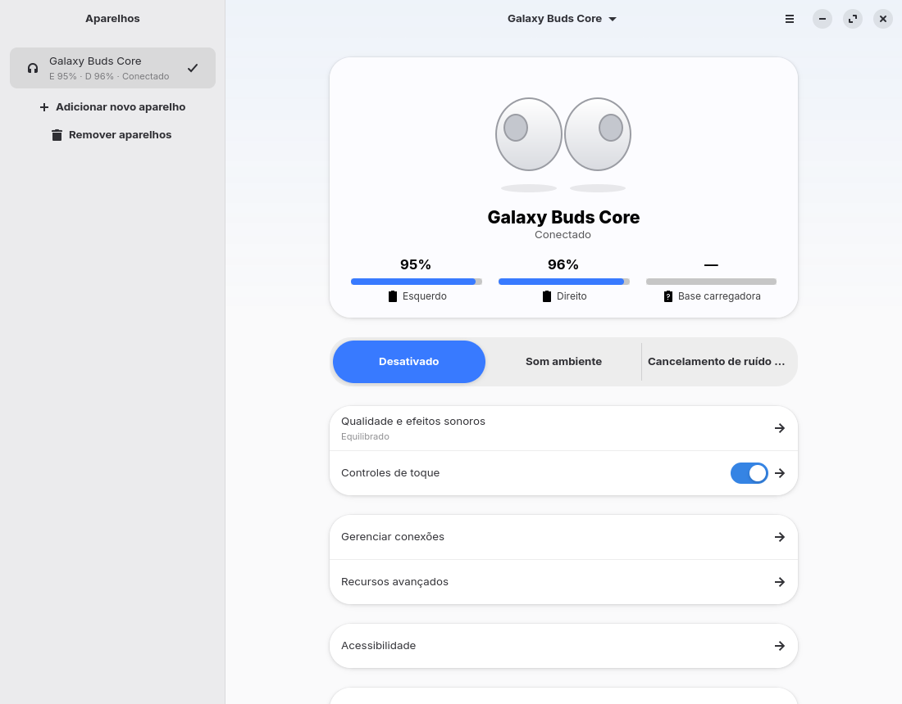

# Buds Studio

Equalizador e ajustes dos **Galaxy Buds** no Linux, com interface GTK4/libadwaita, CLI e
distribuição em Flatpak. Validado em hardware real com o **Galaxy Buds Core (SM-R410)**.

Projeto independente, para interoperabilidade. Não tem vínculo com a Samsung e não usa código,
ícones nem outros recursos dela. O protocolo foi reimplementado a partir da análise em
[`docs/PROTOCOLO.md`](docs/PROTOCOLO.md).

## Instalar e abrir

```sh
./build-flatpak.sh                              # compila, instala (--user) e gera dist/buds-studio.flatpak
flatpak run io.github.mr_l3gne.BudsStudio       # abre o app
```

Em outra máquina: `flatpak install --user dist/buds-studio.flatpak`.

Requisitos para compilar: `flatpak`, o remoto Flathub e o `flatpak-builder` (ou o app
`org.flatpak.Builder`, que o script instala se faltar). Runtime: GNOME 51.



## O que faz

Veja a lista completa, com o status de cada item, em
[`docs/FUNCIONALIDADES.md`](docs/FUNCIONALIDADES.md). Em resumo:

- Presets de EQ, controle de ruído (ANC, ambiente, desligado), volume do som ambiente e balanço.
- Toques: travar, gestos individuais, ação do "tocar e segurar" e ciclo de modos.
- Detecção no ouvido para chamadas, modo de jogo, teste de encaixe e Encontrar meus fones.
- Bateria dos fones e do estojo, carregamento, informações do dispositivo.
- Interface organizada como o app do celular (mapa em [`docs/DESIGN-REFERENCIA.md`](docs/DESIGN-REFERENCIA.md)),
  em coluna única na janela estreita e com barra lateral de aparelhos na janela larga.
- Vários fones ao mesmo tempo, cada um com sua conexão e seus ajustes; "Usar como saída de áudio".
- Tema Claro / Escuro / Seguir o sistema.
- Extras: modo de áudio A2DP/HFP com troca automática, EQ do computador via PipeWire, perfis
  salvos (com exportação e importação em JSON), ícone na bandeja, notificações, início
  minimizado com o sistema, CLI e diagnóstico em hex.

## CLI

O mesmo comando abre a janela (sem opções) ou executa uma ação. Se o app já estiver aberto, a
ação é executada nele.

```sh
flatpak run io.github.mr_l3gne.BudsStudio --status [--json]
flatpak run io.github.mr_l3gne.BudsStudio --info
flatpak run io.github.mr_l3gne.BudsStudio --preset bass        # normal|bass|soft|dynamic|clear|treble
flatpak run io.github.mr_l3gne.BudsStudio --anc anc             # off|anc|ambient
flatpak run io.github.mr_l3gne.BudsStudio --profile "Música"
flatpak run io.github.mr_l3gne.BudsStudio --set balance=16      # --help lista todas as chaves
flatpak run io.github.mr_l3gne.BudsStudio --status --device "Galaxy Buds Core"   # nome ou endereço
flatpak run io.github.mr_l3gne.BudsStudio --audio-profile hfp   # a2dp|hfp
flatpak run io.github.mr_l3gne.BudsStudio --system-eq-preset bass   # flat|bass|treble|vocal|loudness|soft (EQ do computador; app aberto)
flatpak run io.github.mr_l3gne.BudsStudio --find start          # tire os fones do ouvido!
flatpak run io.github.mr_l3gne.BudsStudio --background          # inicia na bandeja
flatpak run io.github.mr_l3gne.BudsStudio --status --debug      # mostra os pacotes em hex
```

Para atalhos de teclado, use os mesmos comandos nas configurações de atalhos do sistema.

## Mudar a aparência

Nenhuma cor, tamanho ou imagem fica no código Python.

| O quê | Onde |
|---|---|
| Cores, espaçamentos, fundo neutro, tratamento da imagem de fundo | `data/style.css` (paleta de referência em variáveis `--bs-*`, com versão escura em `.dark-theme`) |
| Estrutura das telas (grupos, linhas, textos, ícones) | `data/ui/*.ui` (uma página por arquivo: `page-home.ui`, `page-sound.ui`…; dá para editar no Cambalache) |
| Ilustração dos fones no topo | `data/illustrations/` (própria, referenciada pelo `style.css`) |
| Imagens de fundo prontas | `data/backgrounds/` |
| Imagem própria | Preferências → Aparência → "Escolher uma imagem sua…" (é copiada para a pasta de configuração) |

Os comentários no topo de `style.css` e de cada `.ui` listam as classes e os ids que o código usa.
Depois de editar, rode `./build-flatpak.sh` de novo. Para testar direto do código, sem Flatpak,
é preciso GTK ≥ 4.16 e libadwaita ≥ 1.6:

```sh
sh tools/compile-translations.sh
PYTHONPATH=src python3 -m budsstudio
```

## Estrutura

```
src/budsstudio/
  protocol/   quadros, CRC-16/XMODEM, IDs, mensagens, status, modelos (puro, sem Bluetooth)
  transport/  BlueZ via D-Bus (Profile1), socket RFCOMM com fila de envio, reconexão
  services/   estado de cada fone, gerenciador de vários fones, perfis, PipeWire (perfil de
              áudio, saída e EQ do computador), notificações, bandeja, autostart, configuração
  ui/         janela, páginas e diálogos (layouts em data/ui)
  cli/        linha de comando (usa os mesmos services)
data/         style.css, ui/, backgrounds/, ícone, .desktop, metainfo
po/           traduções (pt_BR; o inglês é o idioma do código)
tests/        protocolo (pacotes reais do SM-R410), services, segurança, vários fones e CLI (transporte simulado)
docs/         PROTOCOLO.md, DESIGN-REFERENCIA.md, FUNCIONALIDADES.md, TESTE-MANUAL.md, screenshots/
```

Testes: `cd tests && python3 -m unittest`.

## Configuração

No Flatpak, tudo fica em `~/.var/app/io.github.mr_l3gne.BudsStudio/config/buds-studio/`:
`config.json` (preferências), `profiles.json` (perfis) e `backgrounds/` (imagens suas).

## Permissões do Flatpak

| Permissão | Para quê |
|---|---|
| `--allow=bluetooth`, `--system-talk-name=org.bluez` | conversar com os fones |
| `--socket=wayland`, `--socket=fallback-x11`, `--share=ipc`, `--device=dri` | interface |
| `--filesystem=xdg-run/pipewire-0` | modo de áudio, codec e EQ de sistema |
| `--talk-name=org.kde.StatusNotifierWatcher` | ícone na bandeja |

Notificações e início com o sistema usam portais, sem permissão extra. O app usa um `client.conf`
do PipeWire com `media.category = Manager`, porque o WirePlumber só dá escrita a apps Flatpak
com essa categoria.

## Segurança

- `config.json`, `profiles.json` e os arquivos temporários do PipeWire são gravados de forma
  atômica (arquivo temporário + `fsync` + troca) e só o dono lê (0600; pastas 0700).
- Arquivos lidos (config, perfis importados) têm limite de 1 MiB; JSON aninhado demais, com
  perfis demais (máx. 100) ou com nomes de perfil longos/com caracteres de controle é recusado.
- O `node.name` que vem do PipeWire só chega à config do EQ e ao `pw-metadata` se for
  `bluez_output.<endereço>` (testes em `tests/test_security.py`).
- A CLI repassada a um app já aberto (D-Bus `Run`) limita o número e o tamanho dos argumentos e
  o `--timeout` (até 120 s).
- Nenhuma escrita de manutenção (firmware, reset de fábrica) existe no código.

## Modelos

| Modelo | Situação |
|---|---|
| Galaxy Buds Core (SM-R410) | Validado em hardware |
| Buds+, Live, Pro, Buds2, Buds2 Pro, FE, Buds3, Buds3 FE, Buds3 Pro | Experimental: só bateria, presets e ruído, sem plugin analisado |
| Galaxy Buds (2019) | Não suportado (outro formato de quadro) |

## Licença

GPL-3.0-or-later.
